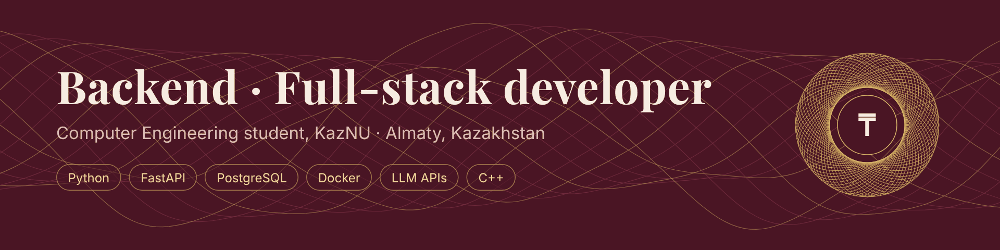

<a href="#english">🇬🇧 English</a> · <a href="#русский">🇷🇺 Русский</a>

### Hi, I'm Karasai 👋

4th-year **Computer Engineering** student at Al-Farabi Kazakh National University (KazNU), looking for a **junior backend / full-stack** role or internship.
I like building things people actually use: from the database schema and API to a clean interface and deployment.

---

### ⭐ Featured project — [AI Finance Tracker](https://github.com/Karasai69/ai-finance-tracker)

Personal finance tracker where you type expenses in plain text — *"taxi 1 200, lunch 1 500, my brother sent 10 000"* — and an LLM turns them into categorized entries. Replaced the Google Sheet I filled by hand every day.

- **Backend:** Python, FastAPI, SQLAlchemy 2.0, Alembic migrations, PostgreSQL
- **AI:** LLM via an OpenAI-compatible API with validation and a rule-based fallback; the app computes every number, the model only phrases them
- **Auth & security:** JWT in httpOnly cookies, scrypt, rate limiting, logout on all devices after a password change
- **Frontend:** vanilla JS calendar, spreadsheet view, mobile screens, PWA, voice input
- **DevOps:** Docker, GitHub Actions (tests on SQLite and PostgreSQL), auto-deploy to Render + Neon

**[▶ Live demo](https://ai-finance-tracker-05rj.onrender.com)** (one-click demo account) · **[Code & README](https://github.com/Karasai69/ai-finance-tracker)**

---

### 💈 Second project — [Barber Booking](https://github.com/Karasai69/barber-booking)

Online booking for a barbershop: clients book through a Telegram bot, barbers mark visits in a web dashboard, the admin sees load and revenue. Built to learn what the first project didn't cover: background jobs, roles and concurrency.

- **No double booking, enforced by the database:** a PostgreSQL `EXCLUDE` constraint on overlapping time ranges; a test fires 10 parallel requests at one slot and exactly one wins
- **Background jobs:** Celery + Redis send reminders 2 hours before a visit and a daily report to the admin, without duplicates
- **Telegram bot:** aiogram 3 — pick a service, barber and free slot, see and cancel your bookings
- **Roles:** admin and barber accounts, JWT for the API and in an HttpOnly cookie for the dashboard
- **DevOps:** Docker Compose with 7 services, GitHub Actions (lint, migration check, tests on PostgreSQL, image build)

**[Code & README](https://github.com/Karasai69/barber-booking)** · **[Design decisions](https://github.com/Karasai69/barber-booking/blob/main/DECISIONS.md)**

---

### 🛠 Tech

**Languages:** Python · C++ · JavaScript · SQL
**Backend:** FastAPI · SQLAlchemy · Alembic · Pydantic · REST APIs · Celery · aiogram
**Databases:** PostgreSQL · SQLite · Redis
**Tools:** Git · Docker · GitHub Actions · Linux · PyCharm · Google Colab

### 📫 Contact

Open to junior backend / full-stack positions and internships — feel free to reach out via GitHub.

<a href="#русский">🇷🇺 Русская версия ↓</a>

 

---
---

### Привет, я Карасай 👋

Студент 4 курса специальности **«Компьютерная инженерия»** в КазНУ имени аль-Фараби. Ищу работу или стажировку **junior backend / full-stack** разработчиком.
Люблю делать то, чем люди реально пользуются: от схемы базы данных и API до понятного интерфейса и деплоя.

---

### ⭐ Главный проект — [AI Finance Tracker](https://github.com/Karasai69/ai-finance-tracker)

Трекер личных финансов: пишешь расходы обычным текстом — *«такси 1 200, обед 1 500, брат перевёл 10 000»* — и LLM превращает их в записи по категориям. Заменил Google-таблицу, которую я каждый день заполнял вручную.

- **Backend:** Python, FastAPI, SQLAlchemy 2.0, миграции Alembic, PostgreSQL
- **ИИ:** LLM через OpenAI-совместимый API с валидацией и запасным вариантом на правилах; все числа считает приложение, модель только формулирует текст
- **Авторизация и безопасность:** JWT в httpOnly cookies, scrypt, ограничение частоты запросов, выход со всех устройств после смены пароля
- **Frontend:** календарь на чистом JS, табличный вид, мобильные экраны, PWA, голосовой ввод
- **DevOps:** Docker, GitHub Actions (тесты на SQLite и PostgreSQL), автодеплой на Render + Neon

**[▶ Живое демо](https://ai-finance-tracker-05rj.onrender.com)** (демо-аккаунт в один клик) · **[Код и README](https://github.com/Karasai69/ai-finance-tracker)**

---

### 💈 Второй проект — [Barber Booking](https://github.com/Karasai69/barber-booking)

Онлайн-запись в барбершоп: клиенты записываются через Telegram-бота, барберы отмечают визиты в веб-панели, администратор видит загрузку и выручку. Сделал, чтобы освоить то, чего не было в первом проекте: фоновые задачи, роли и конкурентный доступ.

- **Двойная запись невозможна на уровне базы:** ограничение PostgreSQL `EXCLUDE` на пересекающиеся интервалы времени; тест отправляет 10 параллельных запросов на один слот, и проходит ровно один
- **Фоновые задачи:** Celery + Redis отправляют напоминание за 2 часа до визита и ежедневный отчёт администратору, без дублей
- **Telegram-бот:** aiogram 3 — выбрать услугу, барбера и свободное время, посмотреть и отменить свои записи
- **Роли:** аккаунты администратора и барбера, JWT для API и в HttpOnly cookie для веб-панели
- **DevOps:** Docker Compose из 7 сервисов, GitHub Actions (линтер, проверка миграций, тесты на PostgreSQL, сборка образа)

**[Код и README](https://github.com/Karasai69/barber-booking)** · **[Архитектурные решения](https://github.com/Karasai69/barber-booking/blob/main/DECISIONS.md)**

---

### 🛠 Технологии

**Языки:** Python · C++ · JavaScript · SQL
**Backend:** FastAPI · SQLAlchemy · Alembic · Pydantic · REST API · Celery · aiogram
**Базы данных:** PostgreSQL · SQLite · Redis
**Инструменты:** Git · Docker · GitHub Actions · Linux · PyCharm · Google Colab

### 📫 Контакты

Открыт к предложениям на позиции junior backend / full-stack и стажировкам — пишите через GitHub.

<a href="#english">🇬🇧 English version ↑</a>

